<picture>
  <source media="(max-width: 600px)" srcset="assets/hero-celular-escuro.svg">
  <source media="(prefers-color-scheme: dark)" srcset="assets/hero-escuro.svg">
  
</picture>

<picture>
  <source media="(max-width: 600px)" srcset="assets/esteira-celular-escuro.svg">
  <source media="(prefers-color-scheme: dark)" srcset="assets/esteira-escuro.svg">
  
</picture>

<picture>
  <source media="(max-width: 600px)" srcset="assets/anatomia-celular-escuro.svg">
  <source media="(prefers-color-scheme: dark)" srcset="assets/anatomia-escuro.svg">
  
</picture>

<picture>
  <source media="(max-width: 600px)" srcset="assets/arquitetura-celular-escuro.svg">
  <source media="(prefers-color-scheme: dark)" srcset="assets/arquitetura-escuro.svg">
  
</picture>

<picture>
  <source media="(max-width: 600px)" srcset="assets/principios-celular-escuro.svg">
  <source media="(prefers-color-scheme: dark)" srcset="assets/principios-escuro.svg">
  
</picture>

<picture>
  <source media="(max-width: 600px)" srcset="assets/stack-celular-escuro.svg">
  <source media="(prefers-color-scheme: dark)" srcset="assets/stack-escuro.svg">
  
</picture>

<picture>
  <source media="(max-width: 600px)" srcset="assets/fechamento-celular-escuro.svg">
  <source media="(prefers-color-scheme: dark)" srcset="assets/fechamento-escuro.svg">
  
</picture>

**[livemkt.v3a.ag](https://livemkt.v3a.ag/)** · [operacoes@v3a.ag](mailto:operacoes@v3a.ag)
