<picture>
  <source media="(max-width: 600px) and (prefers-color-scheme: dark)" srcset="assets/hero-celular-escuro.svg">
  <source media="(max-width: 600px)" srcset="assets/hero-celular-claro.svg">
  <source media="(prefers-color-scheme: dark)" srcset="assets/hero-escuro.svg">
  
</picture>

A área de **Automação & IA** da V3A tira o trabalho repetitivo do caminho dos times, para que o tempo vá para o que só gente faz: criar experiência.

 

<picture>
  <source media="(prefers-color-scheme: dark)" srcset="assets/secao-01-escuro.svg">
  
</picture>

- **Tirar horas de rotina manual do caminho de um time.** Encontrar o que se repete e transformar em fluxo que roda sozinho.
- **Fazer planilha, relatório e painel se montarem sozinhos.** O dado chega onde precisa, no padrão da casa.
- **Colocar IA no dia a dia, com gente no controle.** A IA sugere; a pessoa revisa e decide o que sai.

 

<picture>
  <source media="(prefers-color-scheme: dark)" srcset="assets/secao-02-escuro.svg">
  
</picture>

<picture>
  <source media="(prefers-color-scheme: dark)" srcset="assets/metodo-escuro.svg">
  
</picture>

- **Escuta.** Entender a rotina da área antes de escolher ferramenta.
- **Desenho.** Combinar com quem usa o que entra, o que sai e o que muda.
- **Automação.** Construir em passos curtos, com versão, teste e backup.
- **Evolução.** Acompanhar o uso e melhorar com quem está na ponta.

 

<picture>
  <source media="(prefers-color-scheme: dark)" srcset="assets/secao-03-escuro.svg">
  
</picture>

- **Achismo não tem vez.** Decisão se toma com dado.
- **Autonomia com responsabilidade.** Quem constrói cuida do que coloca no ar.
- **Automação devolve tempo às pessoas.** O objetivo é liberar o time para o que importa.
- **Conhecimento não fica na cabeça de ninguém.** Tudo documentado, versionado e compartilhado.

<b>Como a gente usa IA com responsabilidade</b>

 

- A IA sugere; uma pessoa aprova o que sai para cliente, diretoria ou financeiro.
- Dado de cliente fica onde deve ficar, e nunca em repositório.
- Toda automação tem dono, versão, teste e backup.

 

<picture>
  <source media="(prefers-color-scheme: dark)" srcset="assets/secao-04-escuro.svg">
  
</picture>

 

<picture>
  <source media="(prefers-color-scheme: dark)" srcset="assets/fechamento-escuro.svg">
  
</picture>

**[livemkt.v3a.ag](https://livemkt.v3a.ag/)** · [operacoes@v3a.ag](mailto:operacoes@v3a.ag)
