<picture>
  <source media="(max-width: 600px) and (prefers-color-scheme: dark)" srcset="assets/hero-celular-escuro.svg">
  <source media="(max-width: 600px)" srcset="assets/hero-celular-claro.svg">
  <source media="(prefers-color-scheme: dark)" srcset="assets/hero-escuro.svg">
  
</picture>

A área de **Automação & IA** da V3A tira o trabalho repetitivo do caminho dos times, do briefing ao fechamento de cada job, para que o tempo vá para o que só gente faz: criar experiência.

 

<picture>
  <source media="(prefers-color-scheme: dark)" srcset="assets/secao-01-escuro.svg">
  
</picture>

<picture>
  <source media="(max-width: 600px) and (prefers-color-scheme: dark)" srcset="assets/esteira-celular-escuro.svg">
  <source media="(max-width: 600px)" srcset="assets/esteira-celular-claro.svg">
  <source media="(prefers-color-scheme: dark)" srcset="assets/esteira-escuro.svg">
  
</picture>

Cada job passa por cinco momentos, e em cada um há rotina que pode sair da mão das pessoas: estruturar a abertura, consolidar dados, gerar contratos, documentar entregas, conferir despesas e montar relatórios.

 

<picture>
  <source media="(prefers-color-scheme: dark)" srcset="assets/secao-02-escuro.svg">
  
</picture>

<picture>
  <source media="(max-width: 600px) and (prefers-color-scheme: dark)" srcset="assets/anatomia-celular-escuro.svg">
  <source media="(max-width: 600px)" srcset="assets/anatomia-celular-claro.svg">
  <source media="(prefers-color-scheme: dark)" srcset="assets/anatomia-escuro.svg">
  
</picture>

Toda automação tem a mesma forma: **o que entra** (planilhas, documentos, fotos), **o que é feito** (cruzar, extrair com IA, padronizar), **o que sai** (bases, planilhas, relatórios) e **quem confere** antes de seguir.

 

<picture>
  <source media="(prefers-color-scheme: dark)" srcset="assets/secao-03-escuro.svg">
  
</picture>

<picture>
  <source media="(max-width: 600px) and (prefers-color-scheme: dark)" srcset="assets/arquitetura-celular-escuro.svg">
  <source media="(max-width: 600px)" srcset="assets/arquitetura-celular-claro.svg">
  <source media="(prefers-color-scheme: dark)" srcset="assets/arquitetura-escuro.svg">
  
</picture>

Todo projeto nasce de um card, vira um repositório e só entra em produção pela esteira: ficha validada, testes passando e aprovação de uma pessoa. O que está no ar tem versão e backup diário.

 

<picture>
  <source media="(prefers-color-scheme: dark)" srcset="assets/secao-04-escuro.svg">
  
</picture>

<picture>
  <source media="(max-width: 600px) and (prefers-color-scheme: dark)" srcset="assets/principios-celular-escuro.svg">
  <source media="(max-width: 600px)" srcset="assets/principios-celular-claro.svg">
  <source media="(prefers-color-scheme: dark)" srcset="assets/principios-escuro.svg">
  
</picture>

<b>Como a gente usa IA com responsabilidade</b>

 

- A IA sugere; uma pessoa aprova o que sai para cliente, diretoria ou financeiro.
- Dado de cliente fica onde deve ficar, e nunca em repositório.
- Toda automação tem dono, versão, teste e backup.

 

<picture>
  <source media="(prefers-color-scheme: dark)" srcset="assets/secao-05-escuro.svg">
  
</picture>

<picture>
  <source media="(max-width: 600px) and (prefers-color-scheme: dark)" srcset="assets/stack-celular-escuro.svg">
  <source media="(max-width: 600px)" srcset="assets/stack-celular-claro.svg">
  <source media="(prefers-color-scheme: dark)" srcset="assets/stack-escuro.svg">
  
</picture>

 

<picture>
  <source media="(max-width: 600px) and (prefers-color-scheme: dark)" srcset="assets/fechamento-celular-escuro.svg">
  <source media="(max-width: 600px)" srcset="assets/fechamento-celular-claro.svg">
  <source media="(prefers-color-scheme: dark)" srcset="assets/fechamento-escuro.svg">
  
</picture>

**[livemkt.v3a.ag](https://livemkt.v3a.ag/)** · [operacoes@v3a.ag](mailto:operacoes@v3a.ag)
