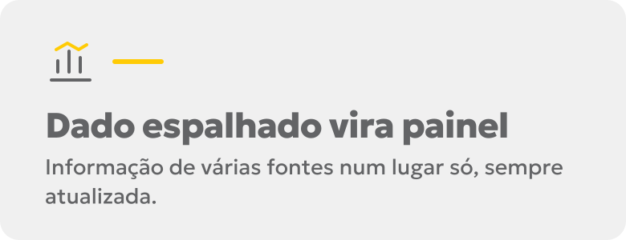
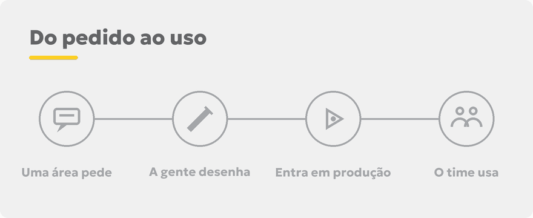

<picture>
  <source media="(prefers-color-scheme: dark)" srcset="assets/banner-escuro.svg">
  
</picture>

 

A V3A vive de **experiência de marca**. A área de **Automação & IA** existe para que o time gaste energia nisso, e não em copiar planilha, montar relatório na mão ou caçar dado espalhado.

A gente olha para a rotina de cada área, encontra o que é repetitivo e transforma em fluxo que roda sozinho, com gente no controle do que importa.

## O que muda

<picture>
  <source media="(prefers-color-scheme: dark)" srcset="assets/card-horas-escuro.svg">
  
</picture>
<picture>
  <source media="(prefers-color-scheme: dark)" srcset="assets/card-planilha-escuro.svg">
  
</picture>
<picture>
  <source media="(prefers-color-scheme: dark)" srcset="assets/card-painel-escuro.svg">
  
</picture>
<picture>
  <source media="(prefers-color-scheme: dark)" srcset="assets/card-relatorio-escuro.svg">
  
</picture>
<picture>
  <source media="(prefers-color-scheme: dark)" srcset="assets/card-ia-escuro.svg">
  
</picture>
<picture>
  <source media="(prefers-color-scheme: dark)" srcset="assets/card-durar-escuro.svg">
  
</picture>

 

<picture>
  <source media="(prefers-color-scheme: dark)" srcset="assets/fluxo-escuro.gif">
  
</picture>

 

## Como a gente trabalha

- <picture><source media="(prefers-color-scheme: dark)" srcset="assets/ic-alvo-escuro.svg"></picture> **Começa pelo problema.** Primeiro entender a rotina da área. A ferramenta vem depois.
- <picture><source media="(prefers-color-scheme: dark)" srcset="assets/ic-passos-escuro.svg"></picture> **Passos curtos.** Entrega pequena, usada cedo e melhorada com quem usa.
- <picture><source media="(prefers-color-scheme: dark)" srcset="assets/ic-pessoa-escuro.svg"></picture> **Gente decide.** O que importa passa por aprovação humana.
- <picture><source media="(prefers-color-scheme: dark)" srcset="assets/ic-camadas-escuro.svg"></picture> **Padrão em tudo.** Versão, backup e documentação desde o começo.

## Com o que a gente constrói

 

<picture>
  <source media="(prefers-color-scheme: dark)" srcset="assets/fechamento-escuro.svg">
  
</picture>

  <a href="https://livemkt.v3a.ag/"><b>livemkt.v3a.ag</b></a> &nbsp;·&nbsp; <a href="mailto:operacoes@v3a.ag">operacoes@v3a.ag</a>

